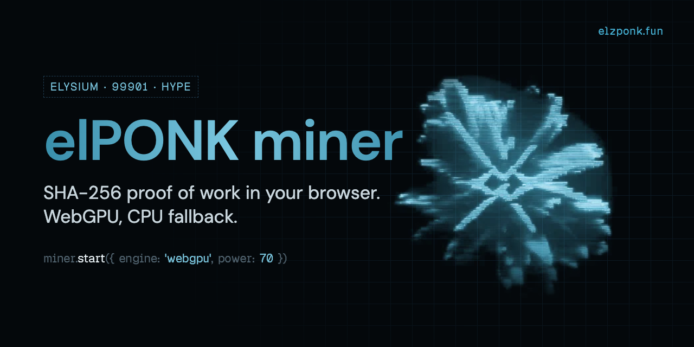

<p align="center"></p>

<p align="center">
  <a href="https://elzponk.fun"><b>elzponk.fun</b></a> ·
  <a href="https://x.com/Enter_Ponk">X</a> ·
  <a href="https://elzponk.fun/docs">Docs</a>
</p>

# elPONK miner

The proof-of-work core behind [elzponk.fun](https://elzponk.fun): SHA-256 mining for HYPE on Elysium, running in the browser. WebGPU does the search; the CPU takes over where WebGPU is missing. Zero runtime dependencies.

| | |
|---|---|
| Network | Elysium, chain ID `99901` |
| Native currency | HYPE |
| elPONK CA | `0x4aa4a53ed3979d728f9eecac16b4801d45cd2066` |

## How a round works

```
attempt = address (20 bytes) | round seed (16 bytes) | nonce (8 bytes, big-endian)
hash    = sha256(attempt)
valid   = first 32 bits of hash < target
```

1. **Connect.** The wallet signs one plain message for the round. It grants no token approval or transfer.
2. **Search.** The GPU hashes nonces in workgroups of 64. The 44-byte attempt fits one SHA-256 block, so the shader only needs the first output word.
3. **Verify.** The server re-hashes the winning nonce. A proof is bound to its wallet and its round seed, so it can't be replayed elsewhere.

Full byte layout and target table: [docs/protocol.md](docs/protocol.md).

Base difficulty is 27 bits (`target = 32`). Holding elPONK raises the target: `boost = 1 + % of supply held`, capped at 101×. Paid upgrades (SPARK 2×, TURBO 4×, OVERDRIVE 8×) multiply it again.

## Use

```ts
import { searchCpu, verifyProof, targetForBoost, startGpuSearch } from '@ponk-elysium/miner';

const target = targetForBoost(1);
const nonce = searchCpu(address, seed, target);   // CPU, anywhere
verifyProof(address, seed, nonce!, target);       // true

const miner = await startGpuSearch({ address, seed, target, power: () => 70, /* ... */ });
miner.stop();
```

## Layout

| File | What it does |
|---|---|
| `src/hash.ts` | SHA-256 in pure TypeScript, attempt layout, padded block for the shader |
| `src/gpu-search.ts` | WGSL compute shader and the WebGPU search loop |
| `src/cpu.ts` | CPU search and proof verification |
| `src/economy.ts` | Difficulty, holder boost, GPU duty cycle, the signed message |
| `src/upgrades.ts` | Upgrade tiers paid in HYPE |
| `src/gpu.ts` | GPU detection and chip weight |
| `src/chain.ts` | Elysium and elPONK constants |

## Try it

```bash
npm run example -- 0xYourWallet 20   # mine one 20-bit proof on the CPU and verify it
npm run bench                        # CPU hashrate of the TypeScript SHA-256
```

The CPU path does about 300k H/s on an Apple M-series core. The WebGPU shader is what makes the 27-bit base target practical in a browser.

## Tests

```bash
npm test
```

Node 23.6+ runs the TypeScript directly, no build step. The suite checks SHA-256 against `node:crypto` across block boundaries, the exact byte layout the shader hashes, that a CPU-found proof verifies and is the first one under its target, boost clamping, upgrade tiers and the signed message.

## License

MIT
